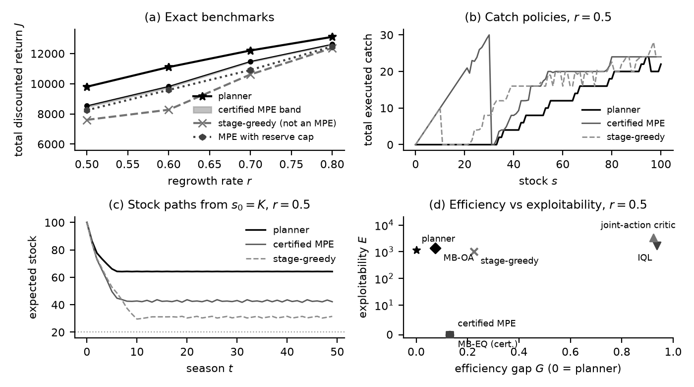
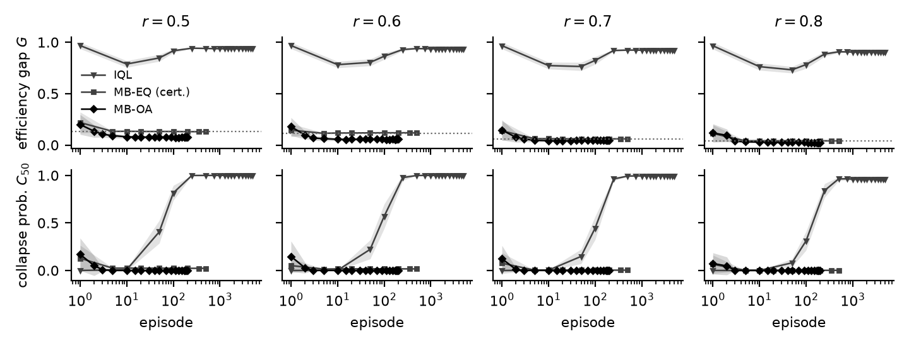
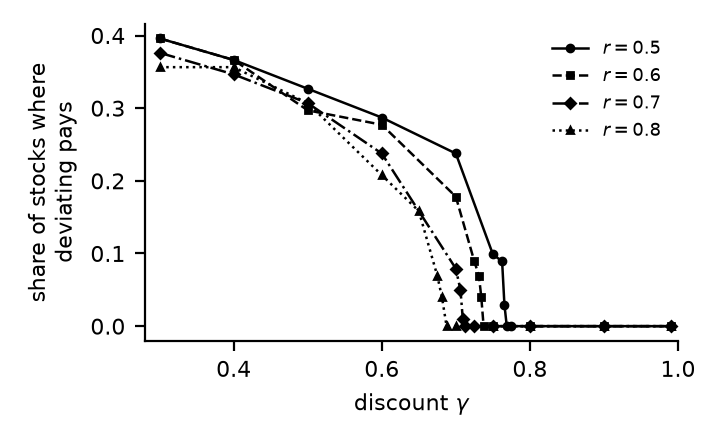

# Fishery-MARL: learning to share a fishery

Two fishing fleets share one lake. Every season each fleet decides how much to catch, and whatever is left
regrows before the next season. The catch is that neither fleet knows how fast the fish regrow, so both have
to learn while the other one is learning too.

This project is our CS-329 (Multi-Agent Systems, IIT Gandhinagar) course project. We model the fishery as a
Markov game, compute the social planner's solution and the Markov perfect equilibria exactly, and then ask how
close different learning fleets get to them, what happens to the fish stock, and what learning costs. Every
number in the report can be regenerated from this repository.

**Team:** Panchal Heet Chirag, Param Tanna, Mehul Prakash Parakh, Pawar Sai Tejeshwar

## What we found

- **The tragedy is real but moderate.** With the planner's return as the yardstick, the Price of Anarchy over
  all certified equilibria is 1.16 when the fish regrow slowly (r = 0.5) and 1.04 when they regrow faster
  (r = 0.8). Several selection rules give genuine equilibria; the one that keeps the highest-payoff stage
  equilibrium in every state does not (a fleet gains about 1030 by deviating from it).
- **Independent Q-learning fails badly.** It ends far below any equilibrium (efficiency gap G of 0.90 to 0.94)
  and the stock collapses in 96 to 100 percent of evaluation runs. A shared team reward does not fix this, so the
  problem is decentralised exploration rather than selfishness.
- **A model helps more than a centralised critic.** A model-based fleet that keeps a Bayesian belief over the
  regrowth rate reaches the equilibrium it is asked to play. A fleet that instead best-responds to a learned
  model of the other fleet ends up close to the planner (G between 0.023 and 0.074) without collapse.
- **Responding to the actual opponent pays off.** Against an over-harvester, the opponent-aware fleet earns
  1436.5 more on average (95% confidence interval of plus or minus 331.3) than the equilibrium-playing fleet, and 3702.1 more at r = 0.8.
- **Not knowing r costs little.** The belief concentrates on the true regrowth rate in every run, and the first
  episode costs about 45 units, roughly 2 percent of an episode's return.
- **A reserve cap removes collapse, but it is not free.** Forbidding catches that would push the stock below 25
  never costs the planner anything, yet it lowers the equilibrium's value by 142 to 563.
- **Cooperation can be enforced, but learners do not find it.** Playing the planner's catch with a grim-trigger
  threat is a subgame-perfect equilibrium whenever the discount factor is at least 0.767, 0.736, 0.711 or 0.684
  (for r = 0.5, 0.6, 0.7, 0.8). We use 0.99, so cooperation is easily sustainable in theory, yet memory-one
  learners never learn to punish.

### Results at a glance



*Left: the planner, the band of certified equilibria, the stage-greedy profile and the equilibrium under a
reserve cap. Right: every profile and learner at r = 0.5. The planner is efficient but easy to exploit,
equilibria cannot be exploited but are inefficient, and the opponent-aware learner (MB-OA) sits near the
planner.*



*Efficiency gap during training, mean and 95% interval over 20 seeds. The dotted line is the best certified
equilibrium.*



*Share of stocks at which breaking cooperation for one season pays off. Once it hits zero, the grim trigger is
self-enforcing.*

## Getting started

You need Python 3.12 or 3.13.

```bash
git clone https://github.com/ParamTanna/Fishery-Marl.git
cd Fishery-Marl
python -m venv .venv
.venv\Scripts\activate            # on Linux or macOS: source .venv/bin/activate
pip install -r requirements.txt
python -m pytest tests -q          # 36 tests, about 20 seconds
```

## Reproducing the results

All results from our runs are saved in `results/`, so the quickest check is to rebuild every table and figure
from them:

```bash
python run_all.py --reproduce      # tests, then all tables and figures, under a minute
```

To run things yourself:

```bash
python run_all.py --quick          # tests plus small smoke runs of the main experiments
python run_all.py --full           # every experiment from scratch, many hours
```

Each experiment can also be run on its own, for example `python experiments/e2_learners.py --full --workers 12`.
The learning experiments take `--workers` for parallel runs; `--quick` gives a small version of most of them.

### Experiments and run times

Times are wall-clock times from our final runs on a 14-core laptop.

| Script | Question | Output | Time |
|---|---|---|---|
| `e0_regime_sweep.py` | Which price-to-cost ratio gives a real tragedy? | `results/raw/e0_regime_sweep.csv` | not timed |
| `e1_benchmarks.py` | Planner and equilibria for each r, all seven selection rules | `results/raw/e1_*.csv` | 13 min |
| `compute_j50_reference.py` | 50-season reference returns for the cost of learning | `results/raw/j50_reference.csv` | seconds |
| `e2_learners.py` | Where do IQL, MB-EQ and MB-OA settle, across r, γ and σ? | `results/raw/e2_*.csv` | 3 h 49 min (16 workers) |
| `e3_unknown_r.py` | What does not knowing r cost? | `results/raw/e3_*.csv` | 11 min |
| `e4_crossplay.py` | Cross-play tournament: who does well against whom? | `results/raw/e4_*.csv` | 3 h 17 min |
| `e5_team.py` | Team reward baselines | `results/raw/e5_*.csv` | 15 min |
| `e6_data_amount.py` | Warm-up length, re-planning interval and prior width | `results/raw/e6_*.csv` | 4 h (12 workers) |
| `e7_safe.py` | Learning with a reserve cap | `results/raw/e7_*.csv` | 1 h 21 min (6 workers) |
| `e8_selection.py` | Every selection rule, and learners under two of them | `results/raw/e8_*.csv` | 3 h 8 min (6 workers) |
| `e9_extensions.py` | Joint-action critic and memory-one learners | `results/raw/e9_*.csv` | 24 min |
| `e10_equilibrium_band.py` | Certified equilibria, Price of Anarchy and Stability, cost of the cap | `results/exact/e10_equilibria.json` | 3 min |
| `e11_cooperation_threshold.py` | Exact grim-trigger threshold | `results/exact/e11_cooperation.json` | 1 min |
| `e12_unsolved_r.py` | MB-EQ when the true r was never solved in advance | `results/exact/e12_unsolved_r.json` | 1 min |
| `make_tables.py` | Summary tables from the raw results | `results/tables/` | seconds |
| `make_report_assets.py` | Every table and figure in the report | `report/tables/`, `report/media/`, `docs/images/` | seconds |

Hyperparameters were tuned once on seeds 0, 1 and 2 (`tune_hyperparams.py`, `results/raw/tuning.csv`) and then
frozen. Every reported number uses seeds 10 to 29.

## How it works

**The game.** The stock s lies between 0 and K = 100. Each fleet requests a catch; if the requests exceed the
stock they are scaled down proportionally. A fleet earns p times its catch minus a convex effort cost, with
p / c = 15. What is left regrows logistically at rate r and is hit by lognormal noise (σ = 0.1). Fleets
discount the future with γ = 0.99. All parameters live in `config.yaml`.

**Exact benchmarks.** Stock and catch are put on grids of 101 and 51 points. The planner is solved by policy
iteration. Equilibria are found by repeatedly picking one equilibrium of each state's stage game (using one of
seven selection rules) and evaluating the resulting policy exactly, until it stops changing. Every equilibrium
is then certified with an exact best response at every stock, using a second implementation of the model
written straight from the equations (`src/exact_check.py`).

**Learners.**

| Name | Idea | Code |
|---|---|---|
| IQL | Independent tabular Q-learning, treating the other fleet as part of the environment | `src/learners/iql.py` |
| MB-EQ | Bayesian belief over r, plays the equilibrium of the estimated game | `src/learners/mb_eq.py`, `src/belief.py` |
| MB-OA | Same belief, plus a model of the other fleet's requests; plays the exact best response to it | `src/learners/mb_oa.py`, `src/opponent_model.py` |
| Team-IQL, Team-Planner | Baselines with a shared reward, and the planner itself | `src/learners/team.py` |
| Joint-action critic | Q-values over both fleets' catches, learned centrally | `src/learners/ctde.py` |
| Memory-one | Q-learning that remembers whether the other fleet over-fished last season | `src/learners/memory_one.py` |

## Repository layout

```
config.yaml          all model, solver and learner settings
run_all.py           test, reproduce or re-run everything
src/                 environment, planner, equilibrium solver, belief, opponent model, metrics, exact checks
src/learners/        the learning fleets
experiments/         one script per experiment (E0 to E12) plus table and figure builders
tests/               unit tests (rationing, quadrature, Levhari-Mirman closed forms, solvers, learners)
results/raw/         raw results of E0 to E9
results/exact/       results of E10 to E12
results/tables/      summary tables built from the raw results
report/              the idea review and the final report (LaTeX sources, tables, figures and PDFs)
docs/images/         figures used in this README
```

## Report

- [`report/Project_Idea_Review.pdf`](report/Project_Idea_Review.pdf): the project idea review we submitted on 30 September,
  with the problem formulation and the plan.
- [`report/Project_Report.pdf`](report/Project_Report.pdf): the final report, which completes the idea review with the
  methodology, all results and the division of work.

The LaTeX sources are next to each PDF, and the tables and figures of the final report are built by
`experiments/make_report_assets.py`.
